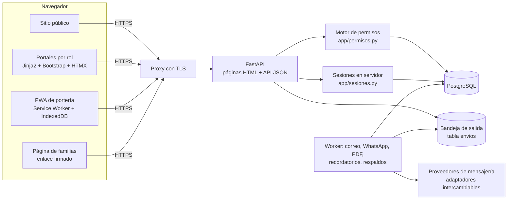
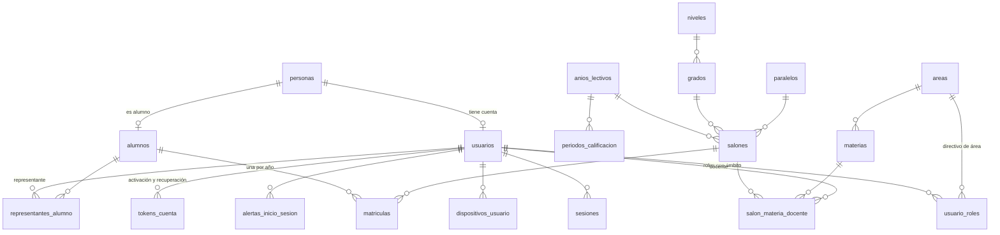

# Arquitectura

Sistema escolar web para una escuela primaria de Ecuador (unos 300 alumnos): sitio público, portales por rol, gestión académica y módulos de bienestar, comunicación y autorizaciones. Proyecto de portafolio con datos ficticios.

## Componentes



Lo que está implementado y lo que llega en fases posteriores se indica en el README.

## Decisiones

| Tema | Decisión | Motivo |
|---|---|---|
| Backend | FastAPI, monolito modular | Un equipo pequeño mantiene un solo despliegue; los módulos se separan por carpeta (`routers/`, `services.py`) |
| Base de datos | PostgreSQL con Alembic | Restricciones e índices parciales que expresan reglas de negocio (un solo año activo, un solo código vigente por persona) |
| Frontend | Plantillas Jinja2, Bootstrap 5.3, HTMX 2 | Sin compilación ni SPA; HTMX solo donde mejora la experiencia (búsqueda en vivo) |
| Librerías de frontend | Servidas desde `/static/vendor`, sin CDN | CSP estricta (`script-src 'self'`) y ningún tercero recibe la IP de un menor |
| Tipografía | Inter alojada en el servidor (OFL) | Mismo motivo; Google Fonts quedaría fuera de la CSP |
| Sesiones | Tabla `sesiones`; la cookie solo guarda un token aleatorio | Permite listar dispositivos, cerrar sesiones a distancia y expirar por inactividad |
| Cola de tareas | Tabla `envios` + worker (próximas fases) | 300 alumnos generan poco volumen; Redis sería un servicio más que operar. Se puede migrar a Celery sin tocar la lógica |
| Reglas de negocio | `app/services.py` | La API JSON y las páginas HTML aplican las mismas validaciones y escriben la misma bitácora |

## Modelo de datos (Fase 1)



Protección de los campos sensibles:

| Dato | Protección |
|---|---|
| Contraseñas | argon2 |
| Secretos TOTP | AES-256-GCM con clave fuera de la base de datos |
| Documentos de identidad | AES-256-GCM, más HMAC para buscar sin descifrar |
| Tokens de sesión, de cuenta, de familia y códigos de recogida | Solo se guarda su HMAC |
| Huella del dispositivo | HMAC de un identificador aleatorio en cookie |
| Correos en pantallas de administración | Enmascarados |
| Bitácora | Sin documentos, teléfonos ni correos; inmutable por trigger en PostgreSQL |

Decisión deliberada: `alumnos.salon_id` repite el salón de la matrícula activa. Portería y autorizaciones lo consultan en cada petición, y así no recorren el historial de matrículas. Lo mantiene `services._matricular`.

## Flujo de acceso

```mermaid
sequenceDiagram
  participant N as Navegador
  participant A as App
  participant B as Base de datos
  N->>A: POST /ingresar (usuario, contraseña, CSRF)
  A->>B: verificar argon2, contador de fallos
  alt 5 fallos
    A->>B: bloqueado_hasta = ahora + 15 min
  end
  A->>B: crear sesión (estado según TOTP)
  A-->>N: cookie sid (HttpOnly, SameSite=Strict)
  alt TOTP configurado
    N->>A: POST /ingresar/totp
    A->>B: revocar sesión pendiente, crear sesión completa (token nuevo)
  else rol exige TOTP y no lo tiene
    N->>A: escanea QR y confirma código
    A->>B: guarda secreto cifrado, token nuevo
  end
  A->>B: registrar dispositivo; si es nuevo, alerta + correo
```

## Fases

| Fase | Contenido | Estado |
|---|---|---|
| 1 | Base, layout y sistema de diseño, roles, TOTP, sesiones y dispositivos, usuarios, estructura académica, matrículas | Hecha |
| 3 | Portal docente y estudiante: tareas, entregas, rúbricas, calificaciones | Siguiente |
| 6 | Autorizaciones y recogida | Backend y página de familias hechos; falta la PWA de portería |
| 2, 4, 5, 7–11 | Sitio público, portal del representante, boletines, bienestar, directivos, evaluaciones, operación | Diseño documentado |
